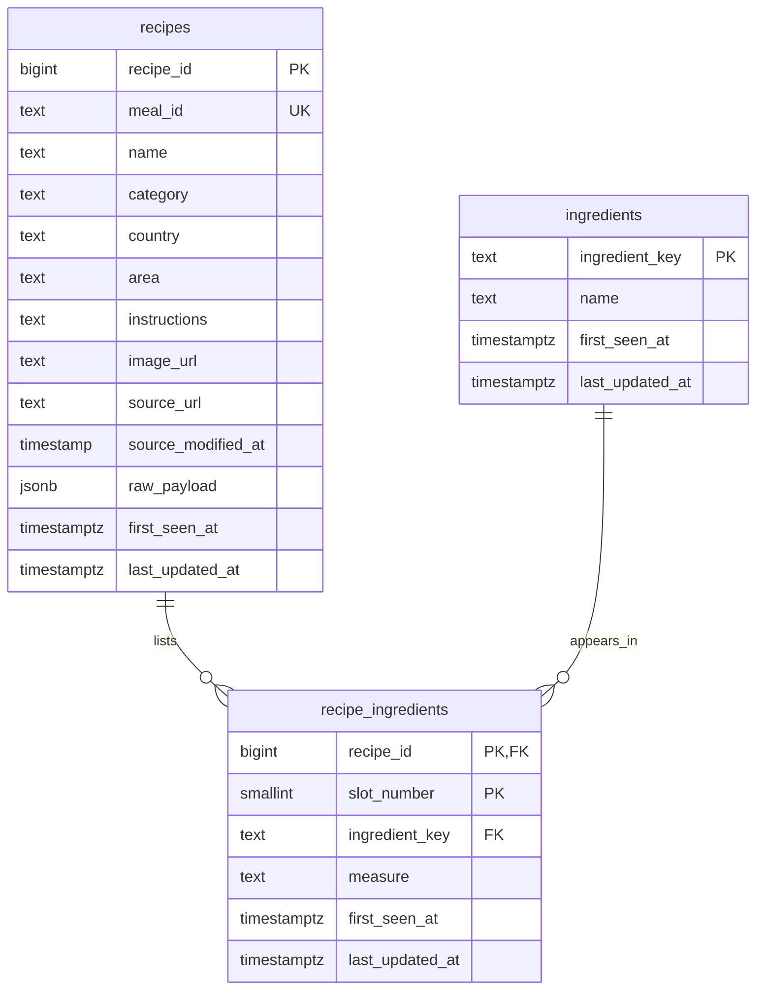

# Recipe database schema

The design uses the [Milestone 1 data dictionary](data_dictionary.md) and the
[October 30 data audit](data_quality.md).

- **recipes** has one row per TheMealDB recipe. The unique `meal_id` preserves
  the source identifier, and `raw_payload` keeps the original fields for future
  comparisons.
- **ingredients** has one row per distinct ingredient spelling after collapsing
  whitespace and folding case. The key supports exact pantry matches across
  recipes. Synonyms and variants can still have separate rows.
- **recipe_ingredients** has one row per populated ingredient slot in a recipe.
  Each row references its recipe and ingredient and stores the optional measure
  as text so values such as “For frying” survive.

I considered making the ingredient unique within each recipe. The snapshot
includes Acaraje with diced red onions in slot 4 and sliced red onions in slot 10.
Using the recipe and slot number as the key preserves both quantities and the
original order when building the shopping list.

Every table tracks when each row first entered the database and when it was last
changed using `timestamptz`. The initial load sets both on insert. TheMealDB's
`dateModified` is optional and has no offset in the snapshot, so
`source_modified_at` uses `timestamp without time zone` to retain the reported
value. The loader creates a recipe with its populated slots in one transaction.

The initial load uses the database owner's `DATABASE_URL`. The scaffold
reserves `APP_DATABASE_URL` for the website and chatbot's separate read-only role.
